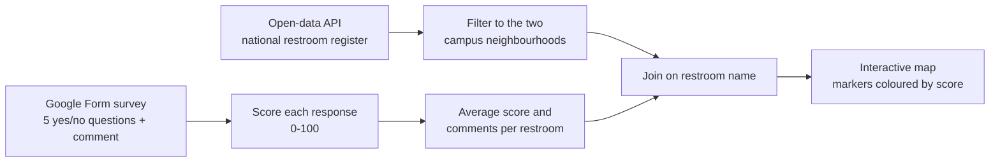

# Public Restroom Map — open data + crowdsourced ratings

Team project for *Introduction to Python for Business Analytics* (NCCU, Spring 2024).

## Problem

Taiwan's Ministry of Environment publishes the location of every public restroom, but not what condition they are in. We wanted one map that shows both: where the nearest restroom is, and what recent visitors said about it.

## Approach



1. **Collect.** Page through the Ministry of Environment open-data API, 1,000 rows per request, until the full national register is downloaded.
2. **Survey.** A Google Form asks visitors five yes/no questions (damaged fixtures, leaking flush, water pressure, toilet paper, overflowing bins) and for a short comment. Responses are read from the linked Google Sheet with `gspread`.
3. **Score.** Each response becomes a 0-100 score, the share of answers that indicate good condition. Scores and comments are aggregated per restroom.
4. **Merge.** Ratings are joined to the official list for the two neighbourhoods around campus in Wenshan District, Taipei.
5. **Map.** Each restroom is a `folium` marker coloured by score (green, orange, red, or grey when nobody has rated it yet). The popup shows address, type, score and comments. The map is saved as a standalone HTML file.

## Files

- `restroom_map.ipynb` — the full pipeline, written as small functions (`fetch_restrooms`, `load_survey`, `score_survey`, `summarise_by_restroom`, `build_map`).

## Running it

```bash
pip install folium pandas requests gspread
```

Set three environment variables first. Nothing secret is stored in the notebook.

| Variable | What it is |
|---|---|
| `EPA_API_KEY` | Free key from the Ministry of Environment open-data platform |
| `GOOGLE_SERVICE_ACCOUNT_FILE` | Path to a Google service-account JSON file with read access to the sheet |
| `SURVEY_SHEET_URL` | URL of the Google Sheet that holds the form responses |

## What we would improve

- Match survey answers to restrooms by an ID or coordinates instead of by name.
- Show how each restroom's score changes over time, not only the average.
- Extend the survey beyond the two neighbourhoods around campus.
