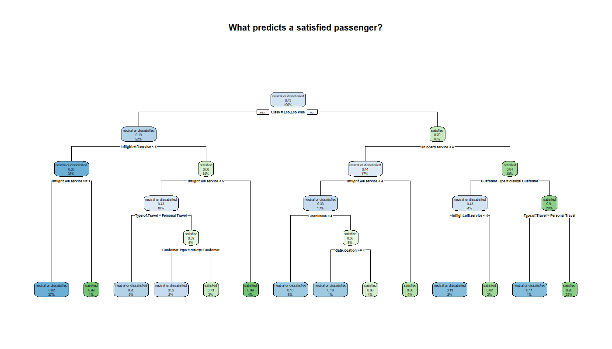
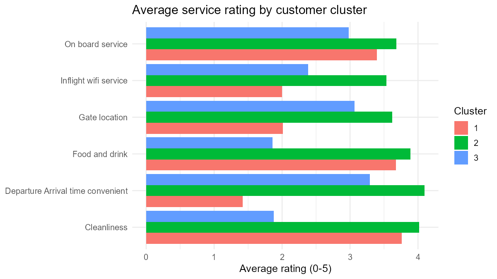
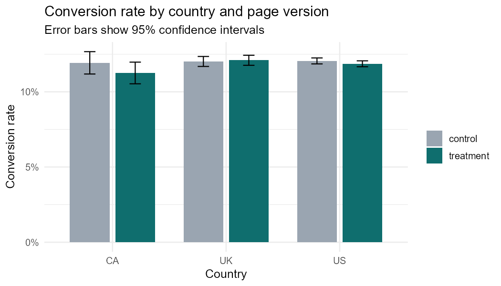

# R Data Analytics Series

Six analyses from a statistics and R programming course (NCCU, Spring 2024). Each script answers one business question with a different technique, prints its results and saves its charts to `figures/`.

| Script | Question | Method | Result |
|---|---|---|---|
| `01_data_wrangling_customer_segments.R` | How do premium members differ from other customers? | `tidyr` reshaping, joins, grouped summaries | In a small teaching dataset, gold and diamond members are 82% female and spend about the same per person as other members (3,039 vs 3,221) |
| `02_craps_simulation.R` | What is a bet in craps worth? | Monte Carlo simulation | 10,000 simulated rounds give a win probability of 0.498 against the exact 0.493, so the expected value of a bet is slightly negative |
| `03_airline_satisfaction_tree_kmeans.R` | What drives airline passenger satisfaction, and which customer groups exist? | Decision tree, k-means, elbow and silhouette methods | 90.1% accuracy on 31,000 held-out passengers. Three clusters with very different satisfaction rates |
| `04_financial_ratios_pca.R` | Which few dimensions summarise 16 financial ratios? | Correlation heatmap, PCA, Kaiser rule | Five components explain 76% of the variance; the first two explain 48% |
| `05_imdb_text_mining_sentiment.R` | What do reviewers say about the most-reviewed film of 2022? | Text cleaning, term frequency, dictionary sentiment | *The Batman*, 3,049 reviews: 65% positive, 27% negative, 8% neutral |
| `06_ab_test_analysis.R` | Should the company switch to the new landing page? | Two-proportion z-test, logistic regression with interaction | No. Conversion is 12.04% on the old page and 11.89% on the new one (p = 0.89), with no difference between countries |

## Highlights

### Airline satisfaction



- Travel class and in-flight wifi each carry about 26% of the tree's predictive power, followed by purpose of travel (16%) and on-board service (12%).
- Loyal business-class passengers travelling for work who rate on-board service 4 or higher are satisfied 93% of the time. They are a quarter of all passengers.
- Economy passengers who rate wifi between 1 and 4 are satisfied 2% of the time. They are 37% of all passengers.



| Cluster | Share of passengers | Satisfied | What sets it apart |
|---|---|---|---|
| 1 | 30% | 53% | Happy with cleanliness and food, unhappy with schedule convenience and gate location |
| 2 | 40% | 57% | Rates every service highly |
| 3 | 31% | 17% | Rates cleanliness and food below 2 out of 5 |

Cluster 3 is the priority: cleaner cabins and better catering address the group that is both large and least satisfied.

### A/B test



The new page converts slightly worse overall, and the group-by-country interaction is not significant (p = 0.37). Recommendation: keep the current page.

### Financial ratios

- PC1 contrasts profitability (profit margin, ROA) with the expense rate.
- PC2 is driven by gross margin and liquidity (quick and current ratios).
- PC3 captures growth and asset turnover.

## Running the scripts

Requires R 4.3 or later with `tidyverse`, `rpart`, `rpart.plot`, `factoextra`, `tm` and `SentimentAnalysis`.

```bash
Rscript 03_airline_satisfaction_tree_kmeans.R
```

## Data

The datasets were provided in class and are not redistributed here. The scripts expect them in a `data/` folder:

- `stock.csv`, `salesdata.csv`, `client_list.csv`, `product_list.csv` — small teaching datasets
- `airline_survey.csv` — 103,904 airline passenger satisfaction surveys
- `financialdata.csv` — 16 financial ratios for 162 listed companies
- `IMDb_Feature Film_2022_review_data.csv` — IMDb user reviews
- `ecommerce.csv` — 294,482 landing-page visits with group, country and conversion
