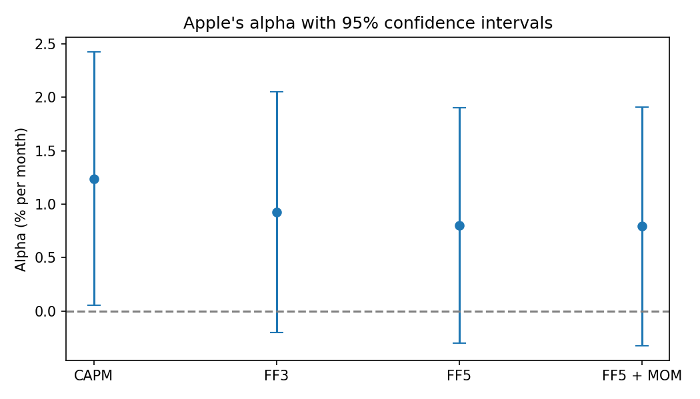
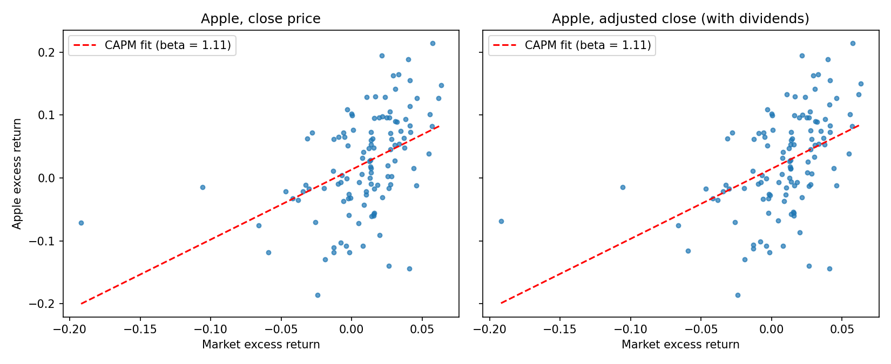
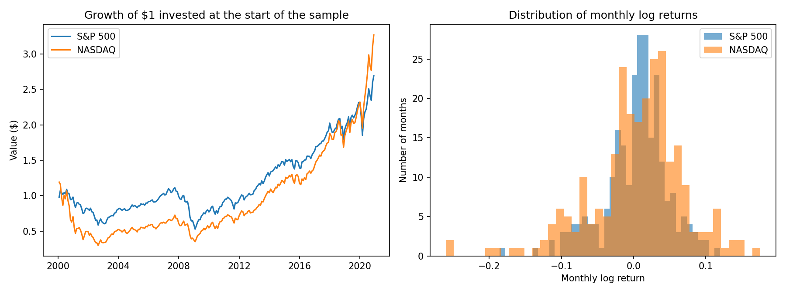

# Financial Econometrics with Python

Four scripts from *Learning Financial Econometrics with Python* (NCCU, Spring 2024), built on `pandas`, `statsmodels` and `scipy`.

| Script | Question | Result |
|---|---|---|
| `01_return_statistics.py` | How do the S&P 500 and NASDAQ compare, 2000 to 2020? | NASDAQ earned slightly more per month (0.47% vs 0.39% log return) with about 1.5 times the volatility. Both are negatively skewed and fat-tailed; correlation 0.86 |
| `02_ols_and_capm.py` | What is Apple's market beta? | Beta 1.11. Alpha of 1.46% a month on dividend-adjusted prices (p = 0.04) |
| `03_factor_models.py` | Does Apple's alpha survive more risk factors? | No. It falls from 1.24% a month under the CAPM to 0.79% with five Fama-French factors plus momentum, and is no longer significant (p = 0.16) |
| `04_monte_carlo_inference.py` | Do confidence intervals deliver the coverage they promise? | Yes. Over 2,000 simulations, 95% intervals contain the true coefficient 95% of the time and 99% intervals 99% |

## Apple's alpha shrinks as factors are added



Under the CAPM, Apple appears to beat the market by more than chance allows. Once size, value, profitability and investment factors are included, the confidence interval covers zero. Much of the apparent outperformance is exposure to the profitability factor (loading 1.03, p = 0.002).



## Other results in the scripts

- **CEO pay:** one more year as CEO is associated with 0.97% higher salary, which is not statistically significant (p = 0.13).
- **Omitted-variable bias:** leaving IQ out of a wage equation raises the estimated return to a year of education from 3.9% to 6.0%.
- **Frisch-Waugh-Lovell:** partialling out the other regressors reproduces the multiple-regression coefficient exactly.
- **Campaign spending:** the hypothesis that equal percentage increases in two candidates' spending cancel out cannot be rejected (p = 0.32).
- **House prices:** an extra 150 sq ft bedroom adds 8.6% to price (95% CI 3.3% to 13.9%).



## Data

The input files were handed out in class and are not redistributed here. All of them can be rebuilt from public sources and saved in a `data/` folder:

| File | Columns | Public source |
|---|---|---|
| `SP500m.csv`, `NASDAQm.csv` | `Date`, `Adj Close` (monthly, 2000 to 2020) | Any index price history, for example Yahoo Finance |
| `data_exercise_2c.csv` | `DATE`, `SP500`, `AAPL_Close`, `AAPL_Adj_Close`, `RF_%` | Apple and S&P 500 price history, one-month Treasury bill rate |
| `data_exercise_3c.csv` | `DATE`, `AAPL_Adj_Close`, `Mkt_RF`, `SMB`, `HML`, `RMW`, `CMA`, `MOM`, `RF` | Kenneth French's data library for the factors |

The remaining examples load teaching datasets from the `wooldridge` package.

## Running the scripts

```bash
pip install pandas numpy scipy statsmodels matplotlib wooldridge
```

```bash
python 03_factor_models.py
```

Run from this folder so the relative `data/` and `figures/` paths resolve.
