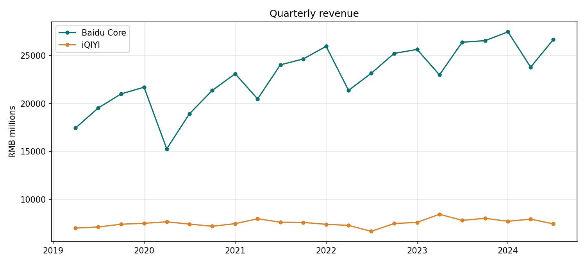
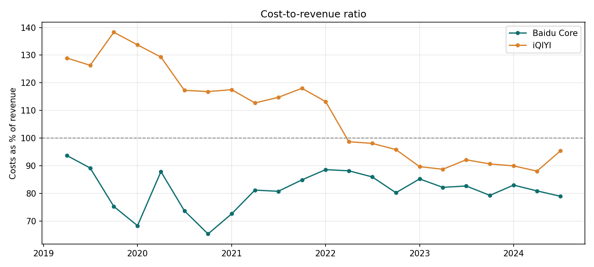
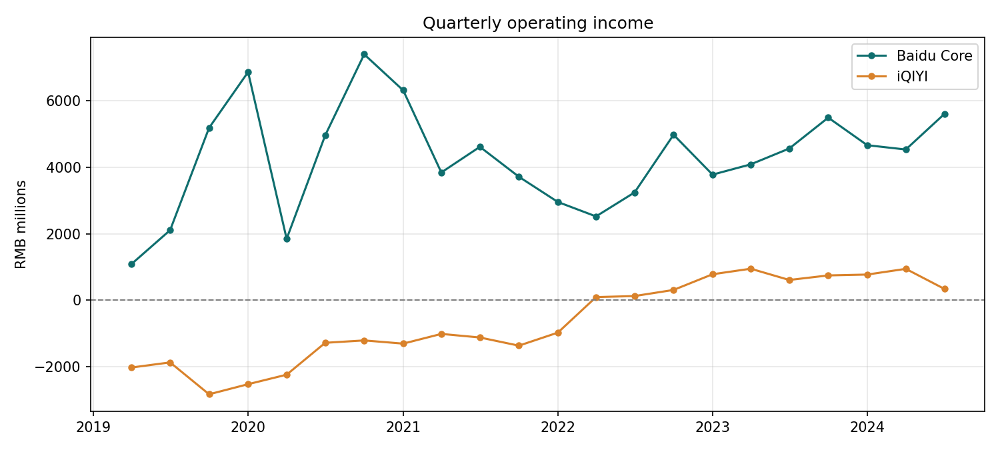

# Baidu Segment Financials

Part of a team project for a business intelligence course at SKEMA Business School (France, Fall 2024).

## Question

Baidu reports two segments: Baidu Core (search, cloud, AI) and iQIYI (video streaming). How do they compare on growth, cost efficiency and profit from 2019 to mid-2024?

## Findings

| | Baidu Core | iQIYI |
|---|---|---|
| Quarterly revenue, Q1 2019 to Q2 2024 | ¥17.5bn to ¥26.7bn (+53%) | ¥7.0bn to ¥7.4bn (+6%) |
| Operating margin, Q1 2019 to Q2 2024 | 6.3% to 21.0% | -29.0% to 4.6% |

- Baidu Core is the growth engine. Its share of combined segment revenue rose from 71% to 78%.
- iQIYI spent more than it earned in every quarter until the end of 2021. It has been profitable at the operating level in every quarter since.
- iQIYI's turnaround came from cutting costs, not from growth: revenue is almost flat over five years.







## Method

Publicly reported quarterly segment figures (RMB millions) are stored in `baidu_financials.py`, which derives the ratios and draws the four charts in `figures/`.

```bash
pip install pandas matplotlib
```

```bash
python baidu_financials.py
```
