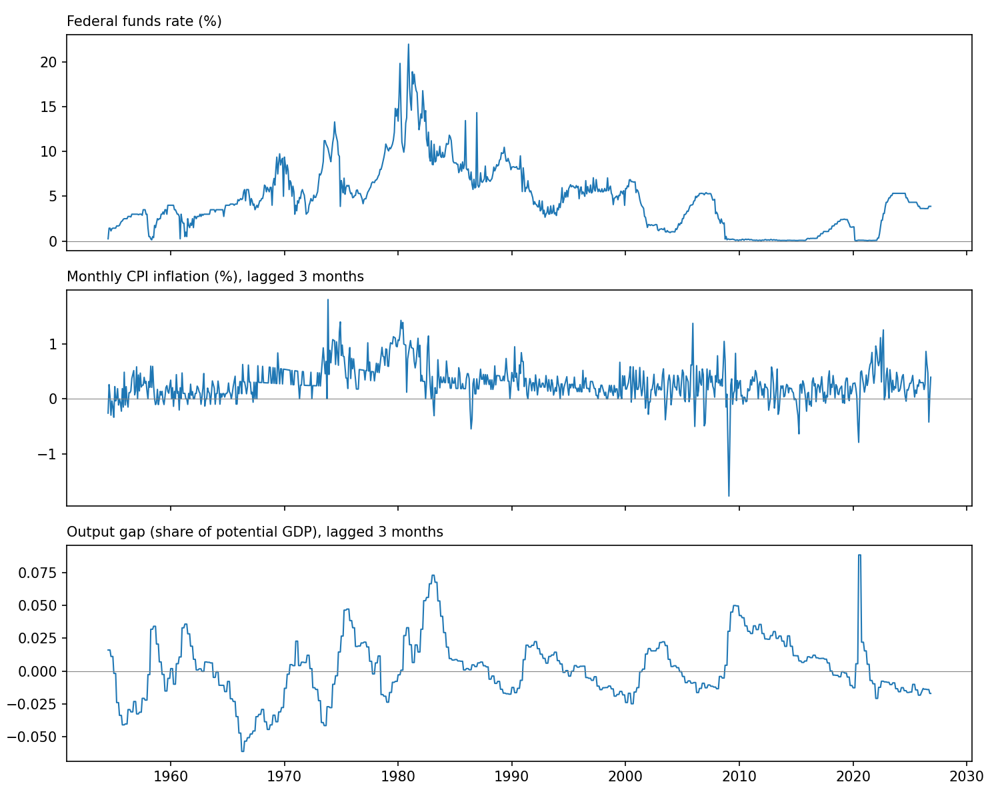

# FRED Macro Dataset

A short, reproducible pipeline that builds a monthly US macro dataset from the Federal Reserve Bank of St. Louis (FRED): the policy rate, inflation and the output gap. No API key is needed.



## Steps

1. Download CPI, the effective federal funds rate, real GDP and real potential GDP.
2. Compute the output gap: `(potential GDP - real GDP) / potential GDP`.
3. Convert CPI to monthly percentage change and the daily funds rate to month-end values.
4. Align everything on a monthly index and carry each quarterly gap value into the following two months.
5. Lag inflation and the gap by three months, so each row pairs the policy rate with information that was already available.
6. Export the dataset, summary statistics, the correlation matrix and a chart to `output/`.

## Result

Run in November 2026, the pipeline returns 867 monthly observations starting in July 1954. The federal funds rate has a correlation of 0.48 with lagged inflation and -0.11 with the lagged output gap.

## Running it

```bash
pip install pandas matplotlib
```

```bash
python fred_macro.py
```
