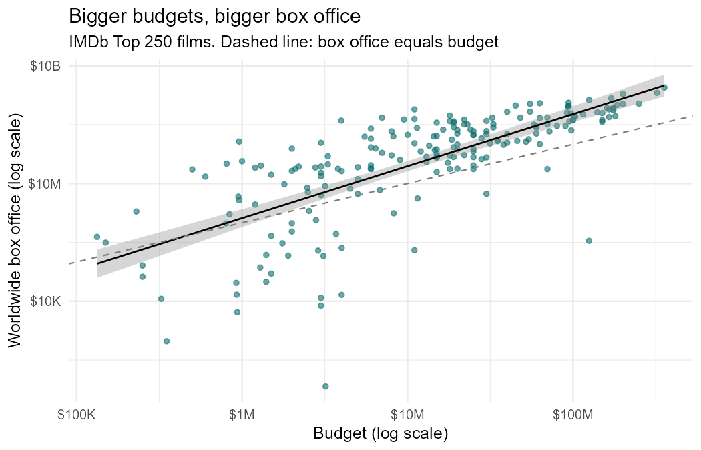
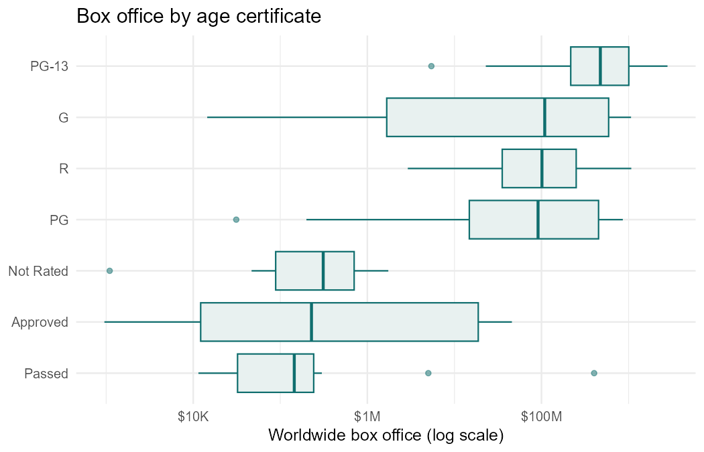

# What Explains the Box Office of IMDb's Top 250 Films?

Team project (three people) for *Statistics II* (NCCU, Fall 2023). The team chose the question and the three hypotheses together; this repository holds the R analysis.

## Question

Cinemas recovered quickly after the pandemic. Among the 250 best-rated films on IMDb, what goes with a high box office: critical acclaim, production budget, or the audience the film is certified for?

## Results

| Hypothesis | Test | Result |
|---|---|---|
| H1: higher-rated films earn more | Regression of log box office on rating | Not supported. p = 0.13, and rating explains 1% of the variation |
| H2: bigger budgets earn more | Log-log regression | Supported. A 1% larger budget goes with 1.3% more box office (p < 0.001, R² = 0.54) |
| H3: box office differs by certificate | One-way ANOVA and Kruskal-Wallis | Supported (p < 0.001). PG-13 films have the highest median, $474 million |



With rating, budget, running time and certificate in one model (adjusted R² = 0.65):

- Budget remains the dominant factor. Its elasticity is 0.94, so box office rises roughly in proportion to budget.
- Rating and running time add nothing once budget is known. Inside a list where every film scores between 8.0 and 9.3, rating has too little spread to matter.
- Films certified "Approved" or "Passed" earn far less than R-rated films with the same budget. Those labels were only used before 1968, so this is an era effect (ticket prices, market size), not an effect of the certificate itself.

Ridge regression with a cross-validated penalty keeps every coefficient's sign and changes the sizes only slightly, so the conclusions do not depend on correlated predictors.



## Method notes

- Box office and budget are heavily right-skewed, so all models use logarithms.
- 203 of the 250 films have both figures and are used in the regressions.
- Two budgets recorded in yen and rupees were being read as dollars. Any budget above $400 million is treated as missing.
- Certificates with fewer than 10 films are excluded from the group comparison and pooled as "Other" in the regression.

## Limitations

- The dataset has no release year, so figures are not adjusted for inflation.
- Other local-currency budgets below the $400 million cut-off may remain.
- The Top 250 is a selected sample of acclaimed films. The findings say nothing about films in general.

## Data

The public *IMDb Top 250 Movies* dataset from Kaggle:
https://www.kaggle.com/datasets/rajugc/imdb-top-250-movies-dataset

It is not redistributed here. Download it and save it as `data/imdb_top_250.csv`.

## Running it

Requires R 4.3 or later with `tidyverse` and `glmnet`.

```bash
Rscript box_office_analysis.R
```
