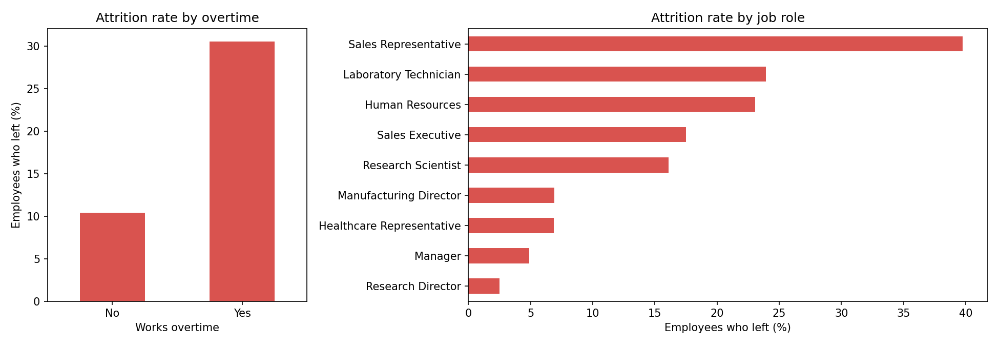
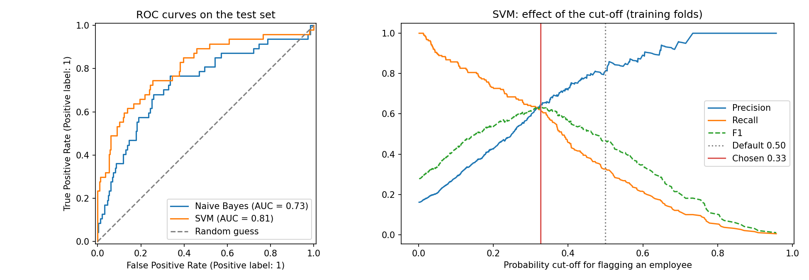

# Employee Attrition: Who Is Likely to Leave?

Course project from the Master of Business Analytics program at the Schulich School of Business (Summer 2026).

## Problem

Replacing an experienced employee is expensive. HR wants to know which employees are at risk of leaving early enough to act, and which factors are behind it.

## Data

1,470 employee records with 30 attributes: pay, role, tenure, overtime, travel, satisfaction scores and whether the employee left. 16% left, so the classes are imbalanced. It is a version of the public IBM HR Analytics attrition dataset (fictional data created by IBM data scientists). The file is not redistributed here; save it as `data/HR_Case.csv`.

## What drives attrition



- **Overtime.** 30.5% of employees who work overtime left, against 10.4% of those who do not.
- **Role.** Sales representatives leave at 39.8%. Managers and research directors leave at under 5%.
- **Travel and marital status.** Frequent travellers (24.9%) and single employees (25.5%) leave about twice as often as others.
- **Pay and tenure.** Leavers earn less on average (4,787 vs 6,833 a month) and have been with the company for fewer years (5.1 vs 7.4).

## Models

Two classifiers were trained on 80% of the data and tested on the remaining 294 employees.

| Model | Cut-off | Accuracy | Recall | Precision | F1 | ROC-AUC |
|---|---|---|---|---|---|---|
| Gaussian Naive Bayes | 0.50 | 0.738 | 0.596 | 0.326 | 0.421 | 0.732 |
| SVM (linear, C = 0.1) | 0.50 | 0.867 | 0.298 | 0.700 | 0.418 | 0.806 |
| SVM, tuned cut-off | 0.33 | 0.850 | 0.489 | 0.535 | 0.511 | 0.806 |



- Accuracy is misleading here: predicting "nobody leaves" already scores 84%. Recall, precision and ROC-AUC are the measures that matter.
- The SVM ranks employees better (ROC-AUC 0.81 against 0.73), but at the default 0.50 cut-off it finds only 30% of the people who leave.
- Lowering the cut-off to 0.33 raises recall to 49% while more than half of the flagged employees are real leavers. In practice HR would review 43 employees and reach 23 of the 47 who left.

### Design choices

- **The cut-off is chosen on training data only.** It comes from out-of-fold predictions inside the training set, so the test results are an honest estimate.
- **Scaling happens inside the pipeline.** The scaler is re-fitted on each training fold and never sees validation rows.
- **Probabilities are calibrated.** An SVM outputs a distance, so it is calibrated to give a probability that HR can read as a risk score.

## Recommendations for HR

1. Audit overtime first. It is the strongest single signal, and it is something management controls.
2. Give sales representatives and laboratory technicians a retention plan: review pay and career paths for these roles.
3. Use the model as a risk ranking for stay interviews, not as an automatic decision. About half of the flagged employees will not leave.

## Running it

```bash
pip install pandas scikit-learn matplotlib
```

```bash
python attrition_model.py
```
